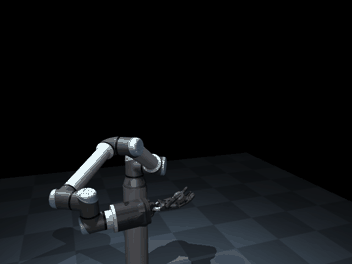
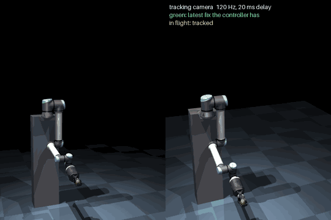
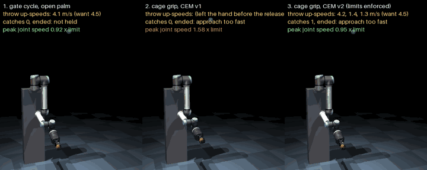
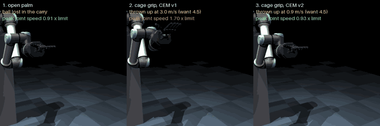
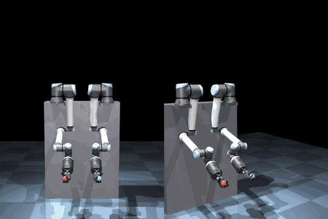
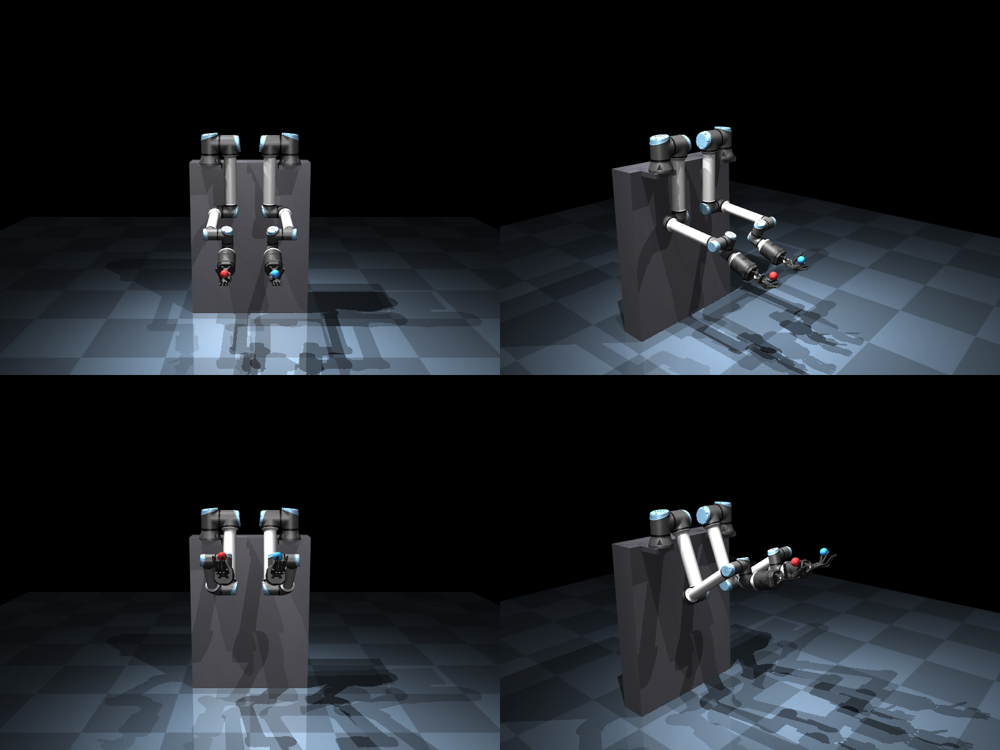
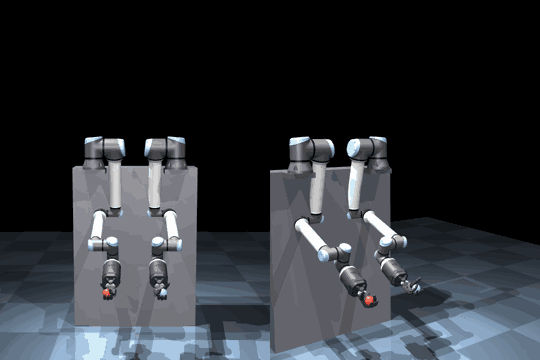

# arm_hand_juggle

A UR10e arm carrying a Shadow Hand (E3M5) in MuJoCo. The goal is continuous toss-and-catch, first with one ball,
then two, then three. Everything runs on a CPU, so the method is model-based: ballistic prediction, scripted palm
trajectories and computed-torque control, with tuning and learning added only where they are needed.

Models come from `mujoco_menagerie` (`universal_robots_ur10e`, `shadow_hand`) and are combined with MjSpec in
`scene.py`. The hand weighs 3.79 kg, which is more than a Panda's 3 kg payload, so the arm is a UR10e
(12.5 kg payload). Joint torques are capped at the real UR10e values (330/330/150/56/56/56 N m). The real joint
speed limits (120/120/180/180/180/180 deg/s) are not in the model, so they are checked on every run.

## Stage 0: feasibility gate (done)



**How fast can it throw?** `stage0_speed.py` solves small linear programs over 1977 palm-up poses that are
reachable without self-collision (`logs/stage0_speed.txt`, `logs/stage0_stroke.txt`). It reports the fastest
straight-up palm speed allowed by the joint speed limits, and the vertical acceleration allowed by the torque
limits.

| | median | best |
|---|---|---|
| straight-up palm speed (no palm rotation) | 1.60 m/s | 2.95 m/s |
| same, worst point over a 0.25 m throwing stroke | | 2.18 m/s |
| with a wrist flick allowed (palm may pitch) | 2.64 m/s | 7.48 m/s |
| upward acceleration from rest | 18 m/s^2 | 39 m/s^2 |

What this means for the plan, in one hand:
- **1 ball** (about 2 m/s, 0.2 m high) fits within the real limits.
- **2 balls** (about 2.5 m/s) is borderline with straight throws.
- **3 balls** (3.4 m/s or more) cannot be done with straight throws on this arm. It would need wrist flicks,
  a second arm and hand, or a faster-than-real arm.

**One toss and catch** (`juggle.py`, `stage0_toss.py`). The palm is driven by operational-space computed
torque. Each toss runs in phases:
1. Lower the palm 0.3 m.
2. Throw upward with a quintic trajectory to 2 m/s. The hand opens flat at 85% of the stroke.
3. Brake to a stop.
4. While the ball is in flight, re-plan the catch every 20 ms from the ball's measured position. The palm meets
   the ball moving at half the ball's speed.
5. Absorb the catch over 0.12 m, then hold.

**Robustness** (`stage0_robust.py`, 120 fresh seeds from 50000). Each seed starts the ball up to 1.5 cm
off-centre, scales the throw speed by a random factor between 0.9 and 1.1, and adds 2 mm noise to the ball
position measurement.

| metric | result |
|---|---|
| ball held after the catch | **120/120** (97-100%) |
| ...and resting back in the palm centre | 116/120 (92-99%); the other 4 rest 4-10 cm off-centre |
| within the real UR10e joint speed limits | 119/120 (peak 0.88 of the limit on average) |
| release speed / apex | 2.14 m/s / 0.24 m |

Bugs found and fixed on the way to these numbers:
- The throw segment ended with a velocity jump. The palm overshot, touched the ball just after release, and this
  was taken for the catch.
- A gentle brake let the palm chase the ball and bump it again.
- The ball dragged on the thumb and curled fingers at release, losing up to half its speed. Opening the hand
  late in the stroke fixed it.
- A ball rocking in the cup mid-stroke was taken for the release.

Comparisons are in `logs/stage0_release_grid.txt`. The 8 variants there land between 109 and 117 of 120, mostly
within noise of each other. The clear gain is that release speed matches the command once the hand opens.

## Stage 1: continuous one-ball juggling, human-style arm, 1 m tosses (passed)


Eight catches in a row with 1 m-high tosses, under the test disturbances: a random velocity kick on every throw
and 2 mm noise on the ball tracker. Joint speed peaks at 0.86 of the UR10e limits, with no torque saturation.

**Arm pose.** The upper arm hangs and the elbow is bent. The base sits on a 1.45 m column. The shoulder_lift,
elbow and wrist_1 joints have parallel axes, so they form a planar 3-joint chain whose speeds add at the palm,
like a human elbow and wrist flick. The same LP as in Stage 0 gives 6.1-6.4 m/s of palm speed in this pose
family, against 2.2-2.95 m/s for the level-palm layout (`logs/stage1_planar_speed.txt`). A 1 m apex needs
4.4 m/s.

**Throw** (`human.py`, `cem_throw.py`). Quintic joint segments: cock, release, brake.
- SLSQP on a rigid-ball model gives the starting plan. That model misses the ball rolling on the turning palm
  (a ~0.8 m/s forward fling).
- CEM then tunes 13 parameters, each candidate scored in the full simulation.
- The throw is scored from all three spots where the ball can rest in the hand
  (`runs/throw2_v443.json`). Worst release: (0.01, 0.04, 4.51) m/s.

**Catch** (`cem_catch.py`).
- Running the throw in reverse does not work as a catch: the palm's sideways motion slides the falling ball
  off. The catch is its own design:
  - Just before arrival, the palm goes to where the ball will be, moving down with it and sideways at the
    ball's horizontal speed.
  - A dip then takes it back to the cocked pose while the fingers curl.
- CEM tunes 8 parameters. The cost includes how far the ball comes to rest from the spot the throw starts
  from, so the cycle closes on itself.
- The ball is tracked from noisy positions with a least-squares parabola fit, never from the simulator's true
  velocity.

**What went wrong on the way:**
- The ball sometimes came to rest wedged between the thumb and first finger, and the throw from there flew
  0.2-0.4 m/s sideways. With the thumb curled along the palm edge as a wall, that resting spot is gone.
- The thrown ball spins at 20-30 rad/s. Catch tests with dropped, non-spinning balls passed while real cycles
  failed. The catch is now tuned on 178 real apex ball states recorded from juggling runs
  (`collect_apex.py`, `data/apex_bank.json`).
- With fewer than 20 ms of samples, the parabola fit reported zero velocity and planned an impossible motion.
  The planner now waits until the fit has enough samples.
- Even after a clean catch, three quarters of the remaining drops happened later: the ball kept its leftover
  sideways speed and spin, rolled across the nearly flat palm and went over the thumb-side edge about 0.5 s
  after the catch. The fix is in-hand feedback (below).
- The first version of that feedback chased sensor noise at its rate limit. It caught as well, but it
  overshot wrist_3's speed limit (1.16x). Filtering, a cap on tilt acceleration with feedforward, and a
  joint-speed budget fixed it.
- When the ball slipped off early in a throw, the controller switched to flight mode and asked the brake
  segment for a time before it had started. The arm's target jumped and the shoulder overshot to 1.48x its
  limit. The arm now finishes the throw, then brakes.

**In-hand feedback** (`inhand.py`). From the catch until the next throw, the palm tilts about its finger axis
against the ball's roll, like balancing a ball on a plate. The sensor is modelled on what a real hand could
have (palm tactile sensors or a wrist camera): the ball's position in the palm at 100 Hz with 1 mm noise, and
only while the ball touches the hand.
- Wanted ball acceleration: a = -(kp e + kd v), where e is the offset from the throw's start spot.
- A rolling ball accelerates at 5/7 of gravity's component along the palm, so the tilt is
  dth = (7/5) a / g_normal.
- The tilt is filtered and rate-limited to a joint-speed budget of 0.8 of the limits.
- The next throw starts only when the sensor reads the ball at rest in the pocket.

**Robustness** (`stage1_robust.py`). Runs are capped at 30 cycles.
- Disturbances: each throw gets a random velocity kick of N(0, 0.05 m/s) per axis, and the ball tracker has
  2 mm of position noise.
- Start: the ball is placed in the hand up to 1 cm from its resting spot.
- Joint limits: a planned motion above 0.97 of the joint speed limits counts as a drop, leaving room for
  tracking error. The limits are also checked on the measured motion.

| controller | seeds | median catches in a row | mean (95% CI) | reach 30/30 | within joint limits |
|---|---|---|---|---|---|
| catch4 (tuned on random spin-free drops) | 50000+ | 1 | 4.1 | 3/120 | 118/120 |
| catch5 (tuned on real apex states) | 50000+ | 4 | 7.4 | 6/120 | 120/120 |
| catch5 + in-hand feedback | 50000+ | **30** | 22.1 (20.2-24.0) | 68/120 | **120/120** |
| catch5 + in-hand feedback, fresh seeds | 90000+ | **30** | 21.4 (19.4-23.4) | 62/120 | **120/120** |

**Stage 1 passes** (median of 20 or more catches in a row, within the joint limits) on both the test seeds and
seeds never used before. The early-start drops in the catch5 row were mostly a test artifact: the ball was
dropped onto the hand up to 1.5 cm off-centre and sometimes not held.

Remaining drops on the fresh seeds:
- 32 runs: the ball fell after the catch.
- 14 runs: the ball was not held.
- 12 runs: the landing point was too far to reach within the speed limits.

## Stage 1 with realistic sensing (passed, narrowly)



Left: outside view. Right: the tracking camera's own view, from where the occlusion ray casts start. The green
marker is the newest camera fix the controller has; it trails the ball by the 20 ms delay. While the ball is in
the hand, the tactile skin takes over. Eight catches in a row, same disturbances as above.

`sensing.py` replaces what the controller knows about the ball with sensor models. `--sensors ideal|real` turns
it on; without the flag, the Stage 1 code path above runs unchanged.
- **Camera** (in flight): the ball's 3-D position at a frame rate, delivered after a delay. A frame is lost when
  the arm or hand blocks the line of sight (MuJoCo ray cast from the camera) or at random. Frames carry their
  capture time, so the parabola fit predicts over the delay.
- **Tactile skin** (palm and fingers): contact (force above a threshold) and the ball's position, estimated from
  the contact points and normals (0.2 mm error on average). The real Shadow Hand has tactile sensing only in the
  fingertips, so this assumes an add-on palm skin.

| preset | camera | tactile |
|---|---|---|
| ideal | every step, no delay, 2 mm noise | 100 Hz, no delay, 1 mm noise |
| real | 120 Hz, 20 ms delay, 2 mm noise, occlusion, 2% dropped frames | 100 Hz, 10 ms delay, 2 mm noise, 0.05 N threshold |

| sensing | seeds | median catches in a row | mean (95% CI) | reach 30/30 | within joint limits |
|---|---|---|---|---|---|
| Stage 1 path | 50000+ | 30 | 22.1 (20.2-24.0) | 68/120 | 120/120 |
| ideal | 50000+ | 30 | 25.0 (23.4-26.6) | 85/120 | 120/120 |
| real | 50000+ | 30 | 21.8 (19.9-23.7) | 64/120 | 120/120 |
| real, fresh seeds | 90000+ | **22** | 19.4 (17.5-21.3) | 47/120 | **120/120** |

- **A bug found on the way.** The first version took the ball's spot at release from the skin. At release the
  ball rolls across the palm at about 0.8 m/s, and a reading up to 10 ms old misplaced it by several mm. The
  catch aims for that spot, and runs lost about 7 catches on average (24-seed isolation runs). The catch now aims
  for the spot and height it was tuned with, as a real robot would; the skin only detects the release. That is
  also why "ideal" beats the Stage 1 path.
- **Occlusion.** With the camera in front of and above the robot (2.5 m away, looking down 20 degrees), the hand
  never hid the ball. A level side-on camera lost 7% of frames and one below the palm 56%, mostly while the ball
  sat in the hand, where the skin takes over.
- **Main cost of realistic sensing:** catch motions that would break the speed limits ("approach too fast",
  23 of the 120 fresh-seed runs, against 5 with ideal sensing). Delayed, sparser camera data means a later,
  faster correction. Stage 2 will need earlier catch planning or more margin.

## Stage 2a: two balls in one hand (stopped: at the arm's limits)



The two-ball loop with each cycle tried, about 1/8 speed (red: ball 1, blue: ball 2, fed one cycle behind).
1: the open palm loses the caught ball in the carry. 2: the cage grip, tuned without hard limits, moves the
arm at 1.58x its speed limits and still cannot reach the next catch. 3: with the limits enforced, ball 2 is
caught and held, but re-thrown at 1.4 m/s instead of 4.5.



One catch -> carry -> throw per cycle (an undisturbed incoming ball): the whole scene on top, following the
thrown ball until it comes back down, and a close-up of the hand below. 1: the ball rolls across the
open palm and drops out during the carry. 2: the cage holds it, but the arm runs at 1.70x its speed limits
and the throw is 3.0 m/s. 3: within the limits, the cage holds it through the carry and it slips out early in
the throw, at 0.9 m/s.

**The timing.** With two balls in one hand, each ball flies F = 2V + D: the hand holds a ball for the dwell D
(catch, carry, throw) and is empty for V (from a throw to the next catch). A 1 m toss flies 0.92 s. Stage 1's
catch-to-throw takes 1.5-2.4 s (a long dip, settling in the hand, a 0.35 s stroke from rest), so the cycle
has to be redesigned, about four times faster.

**Gate** (`stage2_timing.py`, `stage2_timing_cem.py`). A periodic hand motion of two quintic joint segments,
release -> catch -> release, checked for joint speeds, joint torques (inverse dynamics with the hand) and the
palm not pulling away from the held ball.

| cycle | peak joint speed / limit | peak torque / limit |
|---|---|---|
| Stage 1 throw and catch states, squeezed in time | 1.09 or more | 1.09 or more |
| throw and catch co-designed (CEM), catch 0.10 m outward | 0.95 | 0.95 |
| same, catch 0.20 m to the side (world y) | **0.92** | **0.91** |

The best: 1 m tosses, V = 0.22 s, D = 0.48 s, about 1.4 throws per second. Feasible on paper, with
almost no margin for correcting imperfect throws (Stage 1's catch corrections already reach 0.97).

**Full simulation** (`stage2_juggle.py`, `stage2_cem.py`). What went wrong, in order:
- With the catch 0.10 m outward, the rising and falling balls passed 1.6 cm apart and collided. 0.20 m to
  the side leaves about 9 cm and costs the arm less (it uses the otherwise idle shoulder_pan).
- The fed second ball, put in flight only 0.22 s before its catch, had too short a camera track and was
  predicted 3 cm off. It is now fed one cycle earlier.
- The carry pushes the ball sideways at up to 9.5 m/s^2 against 10-15 m/s^2 into the palm, so it rolls
  across the open palm and off, while the palm turns about 40 degrees for the release.
- Tilting the palm against the roll needs about 3 rad/s of extra wrist speed. The wrist has none to spare.
- A cage grip (fingers closed over the ball, thumb opposed; `juggle.CAGE`) holds the ball. A CEM over one
  catch-carry-throw unit found it held 6 of 6, but only at 1.70x the joint speed limits, throwing at 3 m/s.
- With the limits as a hard failure, the ball stays in the cage through the carry but slips out early in
  the throw stroke, at 1-2.4 m/s instead of 4.5.

**Conclusion.** Two balls in one hand is at the edge of what this arm and hand can do. The arm (120/180 deg/s
joints carrying a 3.8 kg hand) leaves about 8% margin for a perfect cycle, and none of the simple ways to keep
the ball seated (palm tilt, finger cage, CEM-tuned timing) fit inside it. Not proven impossible: a hand
motion optimised together with the ball in the hand, a throw designed from scratch for the short carry, or a
funnel-shaped hand (as in Ploeger et al. 2020) might. Three balls in one hand would need ~7 m/s throws and is
out of reach, so the project moves to two arms, where each hand gets far more time per ball.

## Stage 2b: two balls, two arms (passed, ideal and realistic sensing, up to moderate throw errors)



Two balls on the three-ball cascade rhythm, real time, front and three-quarter views, ideal sensing, a random
0.02 m/s kick at every release (12 catches shown).

**The robot** (`scene.build(arms=2)`, `stage2b_scene.py`). Two UR10e arms 0.7 m apart, a right and a left
Shadow Hand; in the Stage 1 poses the palms are 0.35 m apart.

The left arm in `kin.MIRROR_OFF - q` is the exact mirror image of the right arm in q (positions, palm frames,
and inverse-dynamics torques all match to 1e-15), so only the right arm's motion is designed and checked, and
the left arm runs it mirrored, half a hand period later.

**Gate** (`stage2b_timing.py`). Two patterns, each hand cycle tuned by CEM for joint speed, torque and keeping
the ball seated:

| pattern | arm limits | balls in the air |
|---|---|---|
| exchange: both hands throw across at once (F = V) | fine (0.66-1.00) | **collide**: mirror-image throws meet at the centre, even with one hand delayed |
| cascade: alternate throws every Tc / 2, throw inside, catch 10 cm outside (D = 2F - 3V) | **0.72-0.99** for every candidate | 10 cm apart |

So two balls run on the cascade cycle with every third throw empty, which is also exactly the Stage 3 cycle.
Picked: 1 m tosses (F 0.90 s), hand empty V = 0.35 s, holding D = 0.75 s, a throw every 0.55 s.

**Full simulation** (`stage2b_juggle.py`, `stage2b_cem.py`). What it took:
- The gate treats the ball as fixed in the palm. In the simulation it rolls a few mm along the fingers during
  the throw, and 3 mm there is 6 cm at the catch. The catch-carry-throw unit is tuned on the full simulation
  (CEM, 17 numbers: the gate's plus a release-velocity bias, when the hand opens, the finger grip), with 12
  disturbed incoming balls per candidate: front-back landing spread 7.2 cm -> 2.7 cm, worst 50 cm -> 14 cm.
  Opening the hand early is far worse (the ball rolls forward off the fingers); the grip stays closed until
  0.07 s before the release.
- The start-up throw (from rest) is tuned the same way. Its first tuning gamed the score (ball velocity at the
  first instant of separation, before being pushed again); both units now score the free flight 0.06 s later.
- The loop must continue from where the previous segment ends (a jump in commanded velocity while the ball
  is still on the palm cost 0.4 m/s of throw).
- A constant bias in the loop (2.5 cm forward, 11 ms early) is taken out of the release velocity.

**Catch reach** (`stage2b_reach.py`): how far the catch point can move front-back and still be reached in the
0.35 s the hand is empty, within 0.97 of the joint speed limits. The gate's cycle reaches 13-17 cm; the first
full-simulation tunings traded that down to 8 cm toward the body, which is exactly where the loop failed. The
final tuning (`--reach-min 0.12`) keeps 12 cm, and trains on incoming balls twice as disturbed (`--inc-scale 2`).

Tried and dropped: a 1.3 m toss with the hand empty 0.53 s (reach 18-21 cm, but throws scatter twice as much
and errors compound from catch to throw: 15/120 at 0.05 m/s); a linear in-hand predictor of the throw error
from the skin's ball position and the catch error (`stage2b_inhand_fit.py`, R^2 below 0.25: the errors left
are the random kicks themselves, or rare bad throws a linear model cannot see).

**Robustness** (`stage2b_robust.py`, 120 seeds, ideal sensing, a random velocity kick at every release):

| kick per axis | first cycle (v2b) | final cycle (v5), seeds 50000+ | v5, fresh seeds 90000+ |
|---|---|---|---|
| none | 106/120 reach 30 | | **120/120** |
| 0.02 m/s | 113/120 | **119/120** | **119/120** |
| 0.05 m/s (Stage 1's test) | 12/120, median 4 | 35/120, median 16 | 32/120, median 14 |

Throw spread in the tuning unit: 0.9-1.3 cm front-back. At 0.05 m/s the kick alone puts balls ~4.5 cm off per
axis (~6 cm radial). Half the failures are then balls caught far from the palm centre and lost from the hand,
half are catches out of reach. One ball, same 0.05 test: 85/120 (its hand is empty ~0.9 s).

**Realistic sensing** (`--sensors real`: camera 120 Hz, 20 ms delay, occlusion by the arms, 2% dropped
frames; skin 100 Hz, 10 ms delay, 2 mm noise, 0.05 N threshold), same 120-seed test:

| kick per axis | seeds 50000+ | fresh seeds 90000+ |
|---|---|---|
| none | **120/120** | **120/120** |
| 0.02 m/s | **119/120** | **119/120** |
| 0.05 m/s | 30/120, median 14 | |

No measurable cost: each ball is tracked for ~0.5 s of its 0.9 s flight before the catch is committed, so 20 ms
of delay, a few hidden or dropped frames and 2 mm noise barely move the predicted catch point (one-ball Stage 1
was hurt more because its catch corrections were already near the speed limit).



## Next

- **Stage 3:** three balls on the same cycle.
- Open: catching balls ~6 cm off target (the 0.05 m/s test) needs a hand that keeps an off-centre ball, or
  more reach than a UR10e gives in 0.35 s.

```
PYTHONPATH=. MUJOCO_GL=egl python3 stage0_speed.py              # throw-speed feasibility (~35 s)
PYTHONPATH=. MUJOCO_GL=egl python3 stage0_toss.py --gif media_full/stage0_toss.gif
PYTHONPATH=. MUJOCO_GL=egl python3 stage0_robust.py --n 120     # needs robolab (pip install -e ~/robo/robolab)
PYTHONPATH=. MUJOCO_GL=egl python3 stage1_juggle.py --catch runs/catch5_v443.json --cycles 8 --seed 50001 --kick 0.05 --noise 0.002 --gif media_full/stage1_juggle.gif
PYTHONPATH=. MUJOCO_GL=egl python3 stage1_robust.py --n 120 --catch runs/catch5_v443.json             # seeds 50000+
PYTHONPATH=. MUJOCO_GL=egl python3 stage1_robust.py --n 120 --seed0 90000 --catch runs/catch5_v443.json --out logs/stage1_verify_90000.jsonl
PYTHONPATH=. MUJOCO_GL=egl python3 stage1_robust.py --n 120 --catch runs/catch5_v443.json --sensors real --out logs/stage1_sensors_real.jsonl
PYTHONPATH=. MUJOCO_GL=egl python3 stage1_juggle.py --catch runs/catch5_v443.json --cycles 8 --seed 50001 --kick 0.05 --noise 0.002 --sensors real --gif media_full/stage1_sensors_real.gif
PYTHONPATH=.:../robolab MUJOCO_GL=egl python3 stage2_timing_cem.py 0 0.2      # two balls, one hand: periodic-cycle gate (~3 min)
PYTHONPATH=.:../robolab MUJOCO_GL=egl python3 stage2_cem.py --gens 50 --out runs/cycle2_v2.json   # catch-carry-throw unit CEM (~25 min)
PYTHONPATH=.:../robolab MUJOCO_GL=egl python3 stage2_onehand_gif.py media_full/stage2_onehand.gif
PYTHONPATH=.:../robolab MUJOCO_GL=egl python3 stage2_closeup_gif.py media_full/stage2_closeup.gif
PYTHONPATH=. MUJOCO_GL=egl python3 stage2b_scene.py                              # two-arm scene images
PYTHONPATH=.:../robolab MUJOCO_GL=egl python3 stage2b_timing.py                   # two-hand gate (~5 min)
PYTHONPATH=.:../robolab MUJOCO_GL=egl python3 stage2b_cem.py --gens 40 --incs 12 --inc-scale 2 --reach-min 0.12 --init runs/cycle2b_v4.json --out runs/cycle2b_v5.json   # (~25 min)
PYTHONPATH=.:../robolab MUJOCO_GL=egl python3 stage2b_cem.py --start runs/cycle2b_v5.json --out runs/start2b_v5.json
PYTHONPATH=.:../robolab MUJOCO_GL=egl python3 stage2b_reach.py
PYTHONPATH=.:../robolab MUJOCO_GL=egl python3 stage2b_robust.py --n 120 --kick 0.02 --sensors ideal --out logs/stage2b_v5_ideal_kick0.02.jsonl
PYTHONPATH=.:../robolab MUJOCO_GL=egl python3 stage2b_juggle.py --throws 12 --seed 50000 --kick 0.02 --gif media_full/stage2b_ideal.gif
```
