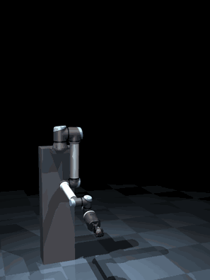

# arm_hand_juggle

A UR10e arm carrying a Shadow Hand (E3M5) in MuJoCo. The goal is continuous toss-and-catch, first with one ball,
then two, then three. Everything runs on a CPU, so the method is model-based: ballistic prediction, scripted palm
trajectories and computed-torque control, with tuning and learning added only where they are needed.

Models come from `mujoco_menagerie` (`universal_robots_ur10e`, `shadow_hand`) and are combined with MjSpec in
`scene.py`. The hand weighs 3.79 kg, which is more than a Panda's 3 kg payload, so the arm is a UR10e
(12.5 kg payload). Joint torques are capped at the real UR10e values (330/330/150/56/56/56 N m). The real joint
speed limits (120/120/180/180/180/180 deg/s) are not in the model, so they are checked on every run.

## Stage 0: feasibility gate (done)


**How fast can it throw?** `stage0_speed.py` solves small linear programs over 1977 palm-up poses that are
reachable without self-collision (`logs/stage0_speed.txt`, `logs/stage0_stroke.txt`). It reports the fastest
straight-up palm speed allowed by the joint speed limits, and the vertical acceleration allowed by the torque
limits.

| | median | best |
|---|---|---|
| straight-up palm speed (no palm rotation) | 1.60 m/s | 2.95 m/s |
| same, worst point over a 0.25 m throwing stroke | | 2.18 m/s |
| with a wrist flick allowed (palm may pitch) | 2.64 m/s | 7.48 m/s |
| upward acceleration from rest | 18 m/s^2 | 39 m/s^2 |

What this means for the plan, in one hand:
- **1 ball** (about 2 m/s, 0.2 m high) fits within the real limits.
- **2 balls** (about 2.5 m/s) is borderline with straight throws.
- **3 balls** (3.4 m/s or more) cannot be done with straight throws on this arm. It would need wrist flicks,
  a second arm and hand, or a faster-than-real arm.

**One toss and catch** (`juggle.py`, `stage0_toss.py`). The palm is driven by operational-space computed
torque. Each toss runs in phases:
1. Lower the palm 0.3 m.
2. Throw upward with a quintic trajectory to 2 m/s. The hand opens flat at 85% of the stroke.
3. Brake to a stop.
4. While the ball is in flight, re-plan the catch every 20 ms from the ball's measured position. The palm meets
   the ball moving at half the ball's speed.
5. Absorb the catch over 0.12 m, then hold.

**Robustness** (`stage0_robust.py`, 120 fresh seeds from 50000). Each seed starts the ball up to 1.5 cm
off-centre, scales the throw speed by a random factor between 0.9 and 1.1, and adds 2 mm noise to the ball
position measurement.

| metric | result |
|---|---|
| ball held after the catch | **120/120** (97-100%) |
| ...and resting back in the palm centre | 116/120 (92-99%); the other 4 rest 4-10 cm off-centre |
| within the real UR10e joint speed limits | 119/120 (peak 0.88 of the limit on average) |
| release speed / apex | 2.14 m/s / 0.24 m |

Bugs found and fixed on the way to these numbers:
- The throw segment ended with a velocity jump. The palm overshot, touched the ball just after release, and this
  was taken for the catch.
- A gentle brake let the palm chase the ball and bump it again.
- The ball dragged on the thumb and curled fingers at release, losing up to half its speed. Opening the hand
  late in the stroke fixed it.
- A ball rocking in the cup mid-stroke was taken for the release.

Comparisons are in `logs/stage0_release_grid.txt`. The 8 variants there land between 109 and 117 of 120, mostly
within noise of each other. The clear gain is that release speed matches the command once the hand opens.

## Stage 1: continuous one-ball juggling, human-style arm, 1 m tosses (in progress)



Six cycles in a row with 1 m-high tosses, no noise. Joint speed peaks at 0.86 of the UR10e limits, with no
torque saturation.

**Arm pose.** The upper arm hangs and the elbow is bent. The base sits on a 1.45 m column. The shoulder_lift,
elbow and wrist_1 joints have parallel axes, so they form a planar 3-joint chain whose speeds add at the palm,
like a human elbow and wrist flick. The same LP as in Stage 0 gives 6.1-6.4 m/s of palm speed in this pose
family, against 2.2-2.95 m/s for the level-palm layout (`logs/stage1_planar_speed.txt`). A 1 m apex needs
4.4 m/s.

**Throw** (`human.py`, `cem_throw.py`). Quintic joint segments: cock, release, brake.
- SLSQP on a rigid-ball model gives the starting plan. That model misses the ball rolling on the turning palm
  (a ~0.8 m/s forward fling).
- CEM then tunes 13 parameters, each candidate scored in the full simulation.
- The throw is scored from all three spots where the ball can rest in the hand
  (`runs/throw2_v443.json`). Worst release: (0.01, 0.04, 4.51) m/s.

**Catch** (`cem_catch.py`).
- Running the throw in reverse does not work as a catch: the palm's sideways motion slides the falling ball
  off. The catch is its own design:
  - Just before arrival, the palm goes to where the ball will be, moving down with it and sideways at the
    ball's horizontal speed.
  - A dip then takes it back to the cocked pose while the fingers curl.
- CEM tunes 8 parameters. The cost includes how far the ball comes to rest from the spot the throw starts
  from, so the cycle closes on itself.
- The ball is tracked from noisy positions with a least-squares parabola fit, never from the simulator's true
  velocity.

**What went wrong on the way:**
- The ball sometimes came to rest wedged between the thumb and first finger, and the throw from there flew
  0.2-0.4 m/s sideways. With the thumb curled along the palm edge as a wall, that resting spot is gone.
- The thrown ball spins at 20-30 rad/s. Catch tests with dropped, non-spinning balls passed while real cycles
  failed. The catch is now tuned on 178 real apex ball states recorded from juggling runs
  (`collect_apex.py`, `data/apex_bank.json`).
- With fewer than 20 ms of samples, the parabola fit reported zero velocity and planned an impossible motion.
  The planner now waits until the fit has enough samples.

**Robustness** (`stage1_robust.py`, 120 fresh seeds from 50000). Each throw gets a random velocity kick of
N(0, 0.05 m/s) per axis, there is 2 mm of position noise, and the ball's start is jittered. A planned motion over
the joint speed limits counts as a drop.

| catch | median catches in a row | mean | reach 30/30 | within joint limits |
|---|---|---|---|---|
| catch4 (tuned on random spin-free drops) | 1 | 4.1 | 3/120 | 118/120 |
| catch5 (tuned on real apex states) | **4** | 7.4 | 6/120 | 120/120 |

Noise-free, the cycle runs 30/30. The pass criterion (median of 20 or more) is **not met yet**. The next levers
are a spin penalty in the throw cost and repeating the record-and-retune loop with the current catch.

## Next

- **Stage 1:** pass means a median of 20 or more catches in a row over 120 seeds, within the joint limits.
- **Stage 2:** two balls in one hand.
- **Stage 3:** three balls, decided using the speed numbers above.

```
PYTHONPATH=. MUJOCO_GL=egl python3 stage0_speed.py              # throw-speed feasibility (~35 s)
PYTHONPATH=. MUJOCO_GL=egl python3 stage0_toss.py --gif media_full/stage0_toss.gif
PYTHONPATH=. MUJOCO_GL=egl python3 stage0_robust.py --n 120     # needs robolab (pip install -e ~/robo/robolab)
PYTHONPATH=. MUJOCO_GL=egl python3 stage1_juggle.py --catch runs/catch5_v443.json --cycles 6 --gif media_full/stage1_juggle.gif
PYTHONPATH=. MUJOCO_GL=egl python3 stage1_robust.py --n 120 --catch runs/catch5_v443.json
```
